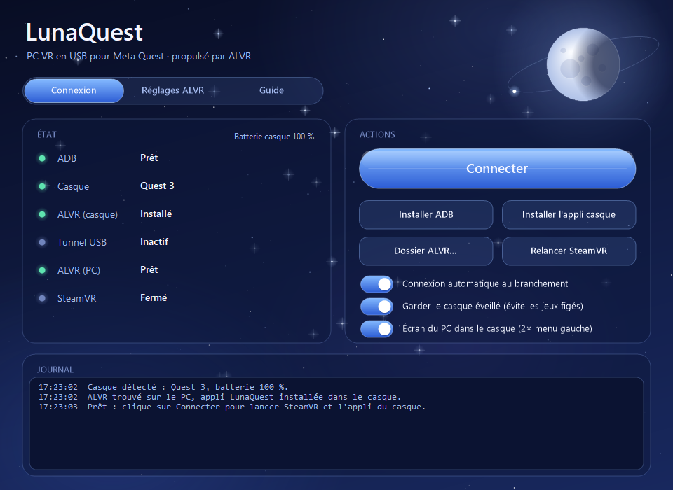

<div align="center">


# LunaQuest

**Joue à tes jeux PC VR sur ton Meta Quest par câble USB, sans l'appli Meta.**

[Site officiel](https://lunaquest-by-ld.netlify.app) · [Télécharger la dernière version](../../releases/latest) · [Mentions légales](https://lunaquest-by-ld.netlify.app/mentions-legales.html)

  

</div>

<p align="center"></p>

LunaQuest est un lanceur pour Windows qui fait passer le streaming [ALVR](https://github.com/alvr-org/ALVR) **par le câble USB** au lieu du Wi-Fi.
Une superbe alternative si ta connexion sans fil n'est pas au top.

## Fonctionnalités

- **Connexion en un clic** : tunnel USB, SteamVR et l'appli du casque se lancent tout seuls.
- **Réglages ALVR intégrés** : images par seconde, débit, codec, résolution, son, micro.
- **Préréglages perso** : enregistre tes réglages par jeu (fournis : Beat Saber et VRChat).
- **Casque toujours éveillé**, pour éviter les jeux figés au lancement.
- **Écran du PC dans le casque** : double appui sur le bouton menu gauche.
- **Mémoire de zone** pour garder la calibration de tes trackers.
- **Appli LunaQuest pour le casque** : client ALVR au thème lunaire, couleurs plus vives.
- **Déconnexion automatique** quand tu quittes l'appli du casque.

## Installation

1. Télécharge `LunaQuest-0.2.1-Setup.zip` dans les [releases](../../releases/latest).
2. Décompresse-le et lance `LunaQuest-Setup.exe`.
   L'installateur n'est pas encore signé : si Windows affiche « Windows a protégé votre ordinateur »,
   clique sur **Informations complémentaires** puis **Exécuter quand même**.
3. Ouvre LunaQuest depuis le menu Démarrer et suis l'onglet **Guide**.

Il te faut : Windows 10 ou 11, un Meta Quest 2, 3, 3S ou Pro en mode développeur, un câble USB-C (USB 3 conseillé),
Steam, SteamVR et [ALVR Streamer](https://github.com/alvr-org/ALVR/releases) v20.14.1.

## Compiler depuis les sources

Le lanceur est écrit en C# et se compile avec le compilateur fourni avec Windows (.NET Framework 4.x), sans rien installer :

```powershell
powershell -ExecutionPolicy Bypass -File build.ps1
```

Résultat : `bin\LunaQuest.exe`, `bin\LunaQuest-Setup.exe` et `dist\LunaQuest-0.2.1-Setup.zip`.
L'appli du casque se compile à part : voir [`client/`](client/README.md).

| Dossier | Contenu |
|---|---|
| `src/` | Code du lanceur (`LunaQuest.cs`), de l'écran PC dans le casque (`DesktopViewer.cs`) et de l'installateur (`Setup.cs`) |
| `client/` | Modifications du client ALVR pour l'appli du casque |
| `site/` | Site web de LunaQuest |
| `res/` | Licences des composants tiers |

## Crédits

- **Idée, conception et tests :** LD
- **Réalisation :** développé avec l'IA [Claude](https://www.anthropic.com/claude) d'Anthropic, sous la direction de LD
- **Streaming :** basé sur [ALVR](https://github.com/alvr-org/ALVR) (licence MIT) et OpenVR de Valve (licence BSD 3-Clause)

## Licence

LunaQuest est distribué sous [licence MIT](LICENSE). Les composants tiers gardent leur licence : voir [`THIRD-PARTY-NOTICES.txt`](res/THIRD-PARTY-NOTICES.txt).

LunaQuest est un projet indépendant, **non affilié** à Meta, Valve, au projet ALVR ni à Anthropic.
Meta Quest est une marque de Meta Platforms, Inc. Steam et SteamVR sont des marques de Valve Corporation.
